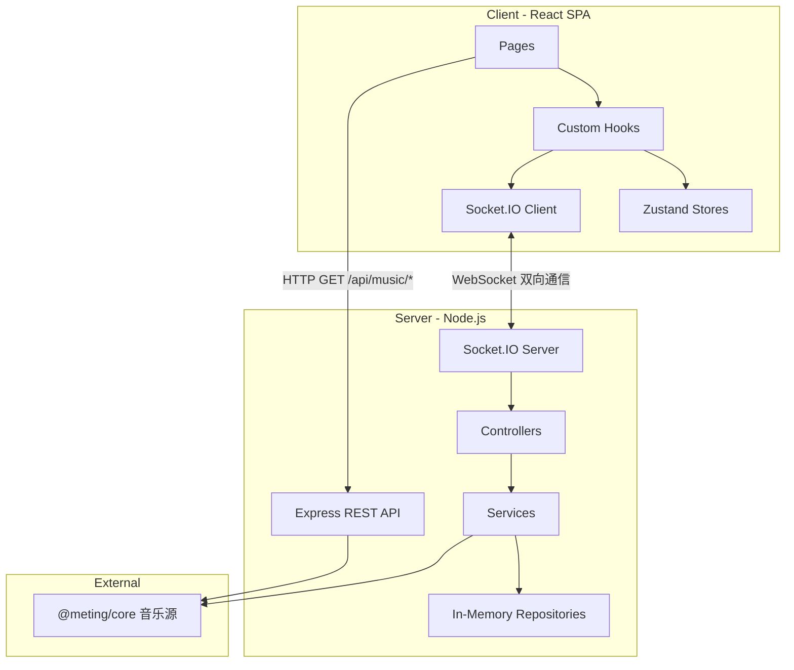

# 架构与数据流

## 整体架构



## Socket 事件清单

| 分类         | 客户端 → 服务端                                                                                                                     | 服务端 → 客户端                                                                                                                                                 |
| ------------ | ----------------------------------------------------------------------------------------------------------------------------------- | --------------------------------------------------------------------------------------------------------------------------------------------------------------- |
| **Room**     | `room:create`, `room:join`, `room:leave`, `room:list`, `room:settings`, `room:set_role`                                             | `room:created`, `room:state`, `room:user_joined`, `room:user_left`, `room:settings`, `room:error`, `room:list_update`, `room:role_changed`, `room:rejoin_token` |
| **Player**   | `player:play`, `player:pause`, `player:seek`, `player:next`, `player:prev`, `player:ready`, `player:sync`, `player:sync_request`, `player:set_mode` | `player:prepare`, `player:play`, `player:preload`, `player:pause`, `player:resume`, `player:seek`, `player:sync_response` |
| **Queue**    | `queue:add`, `queue:add_batch`, `queue:remove`, `queue:reorder`, `queue:clear`                                                      | `queue:updated`                                                                                                                                                 |
| **Chat**     | `chat:message`                                                                                                                      | `chat:message`, `chat:history`                                                                                                                                  |
| **Vote**     | `vote:start`, `vote:cast`                                                                                                           | `vote:started`, `vote:result`                                                                                                                                   |
| **Auth**     | `auth:request_qr`, `auth:check_qr`, `auth:set_cookie`, `auth:logout`, `auth:get_status`                                             | `auth:qr_generated`, `auth:qr_status`, `auth:set_cookie_result`, `auth:status_update`, `auth:my_status`                                                         |
| **Playlist** | `playlist:get_my`                                                                                                                   | `playlist:my_list`                                                                                                                                              |
| **NTP**      | `ntp:ping`                                                                                                                          | `ntp:pong`                                                                                                                                                      |
| **Capacity** | `server:capacity_get` | `server:capacity_update` |
| **Server** | | `server:hello`, `server:restarting` |
| **Admission** | `admission:cancel` | `admission:queued`, `admission:cancelled` |

客户端发送 `server:capacity_get` 获取 `ServerCapacityStatus`，服务端也通过 `server:capacity_update` 广播容量变化。需要等候的创建或加入请求会收到 `admission:queued`，其中包含位次、队列人数、操作、原因和容量快照。准入后服务端继续发送标准房间事件。用户可发送 `admission:cancel` 退出队列，服务端通过 `admission:cancelled` 提供取消原因及可选提示。

通用容量不足时以 `capacity` 为原因按队列顺序放行。全局音频中转拥塞对应 `mapp_stream`，网页请求可继续进入。目标房间达到微应用听众上限时，新的微应用加入请求以 `mapp_room` 排队，网页请求和符合条件的其他房间请求可继续进入。队列重试会重新评估并广播变化后的原因。容量快照中的 `mappPressurePercent` 同时反映通用与中转压力，`mappRoomLimit` 是当前每个房间的微应用听众上限。存在通用容量等候者时，两种剩余名额均显示为零。

已有成员、持有效重入票据者及返回房主或管理员可直接进入。网页切房可直接进入，微应用切房仍受目标房间的 `mapp_room` 上限约束，排队期间保留在原房间。网页实际断线后保留位次 15 秒，旧连接已断开时新连接才可恢复位次。微应用断线立即撤销排队并提示用户重新进入，所有排队请求最多等候 30 分钟。

建房请求受 `create_restricted` 阻塞时，队列保留原有对外原因，同时停止将该请求计入通用容量等候者。启用连接上限时，新的平台握手达到上限即在 JWT 验证前收到 HTTP 503。微应用收到 Socket.IO 的 `SERVER_OVERLOADED` 后在 5 至 8 秒内随机延时重连，保留已确认房间的恢复状态。

平台接入另外定义服务端事件 `identity:ready({ userId })`：仅在显式启用的平台身份适配成功连接后发送，用于确认服务器映射的身份，不含 Cookie、JWT 或房间票据。默认网页 Cookie 路径与现有启动入口保持原样，不会自动启用平台身份。平台入口的事件白名单排除音乐凭据／个人歌单操作，具体房间权限仍由原控制器裁决。实现与启用边界见 [微应用兼容层](mini-app-compatibility.md)。

每次 Socket.IO 连接都会收到 `server:hello`，数据与 `GET /api/version` 一致，包含 `version`、`buildId` 和 `protocol`。关停时先拒绝新的建房及入房请求（`room:error` 的代码为 `SERVER_RESTARTING`），保存快照后广播 `server:restarting { retryAfterMs: 1000 }`，再关闭连接。关停期间的断开只清理 Socket 映射，房间成员和聊天记录保持在保存时的状态。

搜索和歌词另外提供仅在配置 `MAPP_*` 环境变量后才挂载的 `platformMetadata` 路由：复用原匿名 metadata controller；有显式平台认证标记时按受控 JWT 验证，普通 Web Cookie 请求继续原链。只读 target/query 合同位于 shared `mappMetadata.ts`，未开放歌单详情、账号、任意图片地址；TTML 只能按 `source` + `id` 由服务端取固定库，客户端不能指定地址。该路径与媒体读取、宿主装配的状态见 [微应用兼容层](mini-app-compatibility.md)。

## 关键数据模型

```typescript
// 音乐曲目
interface Track {
  id: string
  title: string
  artist: string[]
  artistIds?: string[] // 与 artist 逐项对应的平台歌手 id（目前网易云提供），点歌手名可直达歌手页；缺失时按名字搜索
  album: string
  duration: number
  cover: string
  source: 'netease' | 'tencent' | 'kugou'
  sourceId: string
  urlId: string
  lyricId?: string
  picId?: string
  streamUrl?: string
  requestedBy?: string // 点歌人昵称
  vip?: boolean // 是否为 VIP / 付费歌曲（可能无法播放或仅试听）
}

// 播放模式
type PlayMode = 'sequential' | 'loop-all' | 'loop-one' | 'shuffle'

// 音频质量档位 (kbps)
type AudioQuality = 128 | 192 | 320 | 999

// 客户端可见的房间状态
interface RoomState {
  id: string
  name: string
  creatorId: string
  hostId: string
  hasPassword: boolean
  password?: string | null // 仅 owner 专用状态携带；公开状态不含该字段
  audioQuality: AudioQuality
  users: User[]
  queue: Track[]
  currentTrack: Track | null
  playState: PlayState
  playMode: PlayMode
  queueMode: QueueMode // 'keep' 保留已播放（默认）| 'consume' 播完即移除
}

// 播放状态（含服务端时间戳用于同步校准）
interface PlayState {
  isPlaying: boolean
  currentTime: number
  serverTimestamp: number
  revision: number
}

// 预定执行播放状态（play/pause/seek/resume 广播时使用）
interface ScheduledPlayState extends PlayState {
  serverTimeToExecute: number // 客户端应在此服务器时间点执行动作
}

// 歌单元数据
interface Playlist {
  id: string
  name: string
  cover: string
  trackCount: number
  source: MusicSource
  creator?: string
  description?: string
}

// 用户（RBAC: owner > admin > member）
// hostId 是自动选举的播放主持(conductor)，不是可见角色
interface User {
  id: string
  nickname: string
  role: UserRole
}
type UserRole = 'owner' | 'admin' | 'member'

// 聊天消息
interface ChatMessage {
  id: string
  userId: string
  nickname: string
  content: string
  timestamp: number
  type: 'user' | 'system'
}
```

## 播放同步机制

采用**事件驱动同步 + 周期性比例漂移校正**架构：NTP 时钟同步 + Scheduled Execution + 比例控制漂移校正（EMA 平滑 + proportional rate + hard seek）。

**三层防护**：

1. **NTP 时钟同步**：保证各客户端时钟与服务器对齐（时间衰减加权中位数）
2. **Scheduled Execution**：离散事件（play/pause/seek/resume）通过预定执行消除网络延迟差异（P90 RTT 自适应调度）
3. **周期性比例漂移校正**：客户端用服务端时间锚点计算预期位置，在本地采样并校正漂移。`PLAYER_SYNC_REQUEST` 可获取服务端当前快照，用于重新校准锚点

## Layer 1：NTP 时钟同步 + RTT 回报

客户端与服务器通过 `ntp:ping` / `ntp:pong` 事件交换时间戳，计算 `clockOffset`（客户端与服务端时钟差值），使 `getServerTime()` 返回与服务端对齐的时间。

- 初始阶段：快速采样（每 50ms）收集 20 个样本，使用 `switchedRef` 保证仅在首次校准完成时切换到稳定阶段
- 稳定阶段：每 5 秒一次 NTP 心跳
- NTP 仅在用户进入房间后启动（`ClockSyncRunner` 渲染在 `RoomPage` 中），大厅用户不运行时钟同步
- 选取 RTT 最低的 25% 样本（至少取 3 个，少于 3 个时全取），再计算 offset 的**时间衰减加权中位数**（半衰期 30 秒），减少高 RTT 排队造成的单向时延偏差
- **`performance.now()` 锚点**：`getServerTime()` 基于 `performance.now()`（单调递增）计算时间流逝，不受系统时钟突变影响（NTP 调整、手动改时间、休眠唤醒）。每次 `processPong` 刷新锚点：`anchorServerTime = Date.now() + medianOffset`、`anchorPerfNow = performance.now()`
- **RTT 回报**：每次 `ntp:ping` 附带 `lastRttMs`（客户端中位 RTT），服务端在 `NTP_PING` handler 中调用 `roomRepo.setSocketRTT()` 存储，用于自适应调度延迟计算
- 核心模块：`clockSync.ts`（采样引擎 + `getServerTime()` + `getMedianRTT()` + `computeWeightedMedian()`）、`useClockSync.ts`（React Hook，在 SocketProvider 中运行）

## Layer 2：Scheduled Execution（预定执行）

所有多客户端同步动作（play、pause、seek、resume）由服务端广播 `ScheduledPlayState`，包含 `serverTimeToExecute` 字段。客户端收到后通过 `setTimeout(execute, serverTimeToExecute - getServerTime())` 在同一时刻执行，消除网络延迟差异。

- 服务端根据房间 **P90 RTT** 动态计算调度延迟：`max(P90RTT * 1.5 + 100, 300ms)`，上限 3000ms。P90 避免单个慢连接拖累整个房间，房间人数 ≤3 时退化为取 max
- RTT 由客户端 NTP 测量后通过 `ntp:ping` 事件回报，服务端以指数移动平均（alpha=0.2）平滑存储在 `roomRepository` 的 per-socket RTT map
- 全部客户端（含操作发起者）统一收到广播并在预定时刻执行
- **已提交状态与待执行状态分离**：`room.playState/currentTrack` 保存服务端当前状态，其中准备中的曲目处于暂停、进度为 0。未来的 play/pause/resume/seek/stop 存放在 `room.pendingPlayback`，到 `serverTimeToExecute` 才提交。同步请求读取当前状态，新加入的客户端另外接收正在准备或即将执行的动作
- **revision 边界**：准备和计划动作各自取已提交、待准备和待执行 revision 中的最大值加 1。定时器还校验待执行动作的对象身份，防止已被替换的回调提交。切换房主或其代表 Socket 时保留播放时间戳、位置和 revision
- **切歌准备（`player:prepare` / `player:ready`）**：解析曲目播放链接和封面后，服务端记录当时在房间内的 Socket，广播 `{ track, revision, deadlineAt }`，客户端加载音频后回传 `{ trackId, revision }`。收到全部匹配确认、剩余未确认连接全部离开，或等待达到 3,500ms 时，服务端广播带新 revision 和执行时间的 `player:play`。准备期间加入的连接收到同一份 `player:prepare`，等待集合保持在切歌时的快照。空房间直接广播计划播放，有效的新控制取消旧准备定时器
- Scheduled action（seek/pause/resume）执行时自动重置 `rate(1)`，SEEK 同时应用 payload 中的最终 `isPlaying`，避免 PAUSE/RESUME 被后续 SEEK 取消后出现客户端与服务端播放状态相反；执行后同步更新 `roomStore.playState`（不含 `serverTimeToExecute`），确保 recovery effect 读到最新状态
- **加载与执行边界**：收到 RESUME 或播放态 SEEK 时，加载中的音轨保持暂停，直到受 action ID 保护的执行回调才启用期望播放目标。若到点仍未加载完成，不提前排队 seek/play，由 `onload` 根据当时的服务端时间计算补偿位置并只启动一次；已在播放的 SEEK 则持续播放到执行时间后再定位，不重复启动。
- **预取下一首（`player:preload`）**：服务端下发计划播放后，以及队列或播放设置变化后，提前解析下一首的链接，写回队列项的 `streamUrl`，并广播 `player:preload { track }`。随机模式为当前曲目保存一个选定的下一首，切歌时优先使用；该曲被移除时重新选择。消耗队列跳过当前曲目，微应用单曲循环复用当前解码缓冲。网页端按曲目 ID 和链接在双槽位解锁 `<audio>` 池中保留一份静音预加载实例，准备或播放同一音源时直接接管。微应用提前获取压缩音频字节。预取失败时按正常路径加载
- **取消过期操作**：较新的控制动作取消尚未执行的定时器和音频时钟排程，执行时校验 revision。`scheduledPlayback` bridge 负责跨 Hook 取消。加载期间记录最新的期望播放状态，解码结束后按最新目标启动。准备阶段的本机加载失败也回传就绪，播放受阻或停滞时只尝试本机恢复

## Layer 3：周期性比例漂移校正（EMA + Proportional Rate + Hard Seek）

所有成员按服务端时间锚点和 NTP 校准时钟估算预期位置。服务端通过 `estimateCurrentTime()` 回复 `PLAYER_SYNC_RESPONSE`，携带 `trackId`，供客户端识别切歌前发出的旧响应。

- 网页和微应用每 250ms 在本地采样，取最近 5 个漂移值的中位数后进行 EMA 平滑（alpha=0.2），每 15 秒发送一次 `PLAYER_SYNC_REQUEST` 校验时间锚点
- 漂移在 15ms 内恢复正常速率。网页端比例调速上限为 ±2%，跳转阈值为 `max(500ms, medianRTT / 2 + 100ms)`。微应用调速上限为 ±0.3%，连续 3 次超过 120ms 时使用短交叉淡化跳转
- 设备延迟补偿应用于播放起点和漂移目标。正值使媒体时间轴提前相应毫秒数，以抵消声音到达耳朵的延迟
- UI 展示平滑后的漂移值。检测到外部插件连续覆盖保音调调速时，客户端停用调速并保留跳转校正

典型场景：手机息屏暂停后解锁、浏览器后台标签页节流、网络波动导致的累积偏移。

## 服务端播放时间线与自动续播

- 服务端提交的 `playState` 是播放时间线的唯一来源。`estimateCurrentTime()` 在播放态将 `currentTime` 加上自 `serverTimestamp` 起经过的非负时间，并限制在已知曲目时长内。旧客户端的 `player:sync` 继续执行数据和房间成员校验，通过后仅记录调试日志
- 任意在线成员都可在曲目结束时发送 `player:next { auto: true, trackId, revision }`。服务端要求当前已提交状态为播放中且曲目和 revision 一致。时长已知时，预期播放位置必须落在曲末 5 秒内。手动切歌继续使用原有权限和限流
- 提交播放、恢复、播放态定位或刷新链接后的播放时，服务端按剩余时长加 5 秒设置兜底定时器。触发时再次校验房间对象、曲目、revision、播放状态以及待准备和待执行动作，然后进入正常下一首流程。控制动作和房间清理取消旧定时器。该机制覆盖房主断线和客户端未上报结束的情况

### 重连与重启恢复

- 某身份的最后一个 Socket 意外断开后，房间记录该身份并允许其在 60 秒内免密码返回。主动离开、降级或房间密码变更会撤销相应的重入资格。重入仍兼容 `room:rejoin_token`，成功返回不会重复发送入房消息。
- 加密快照保存房间设置（含密码）、持久角色、队列、播放时间线、在线身份、仍可重入的离线身份，以及最近 200 条聊天。当前和下一首可保留播放链接；音乐账号 Cookie、身份凭据、重入票据和 Socket 运行状态均留在内存。
- 启动在接受连接前恢复房间。房间初始为空，原成员默认有 120 秒免密码返回，超时仍为空则删除房间。停机间隔默认不超过 120 秒时，播放时钟继续按墙钟推进；超过时暂停在快照保存时的位置。
- 首位成员入房时才恢复曲末兜底定时器，已播完则立即切到下一首。当前播放链接过期时，等待对应音源的 `auth:set_cookie` 将 Cookie 加入房间账号池，最长等待 2 秒后再解析链接。配置见 [部署方案](deployment.md)。

## 播放模式

房间支持 4 种播放模式（`PlayMode`），由 `room.playMode` 字段控制，默认 `loop-all`：

| 模式         | 说明                                   |
| ------------ | -------------------------------------- |
| `sequential` | 顺序播放，末尾停止                     |
| `loop-all`   | 列表循环，末尾回到第一首               |
| `loop-one`   | 单曲循环，重播当前曲目                 |
| `shuffle`    | 随机播放，从队列随机选一首（排除当前） |

- **Owner/Admin** 直接 emit `player:set_mode`，服务端更新 `room.playMode` 并广播 `ROOM_STATE`
- **Member** 通过 `vote:start { action: 'set-mode', payload: { mode } }` 投票切换
- Member 拥有点歌权限；当房间当前没有歌曲时，向空队列添加歌曲会触发服务端的系统自动播放，这不是 Member 直接获得 Player 控制权限
- **指定播放**：播放列表工具栏提供 Play 按钮，Owner/Admin 直接 emit `player:play`；Member 通过 `vote:start { action: 'play-track', payload: { trackId, trackTitle } }` 投票播放
- **投票移除**：播放列表工具栏的删除按钮对所有用户可见，Owner/Admin 直接 emit `queue:remove`；Member 通过 `vote:start { action: 'remove-track', payload: { trackId, trackTitle } }` 投票移除
- 服务端 `queueService.getNextTrack(roomId, playMode)` 根据模式返回下一首；`getPreviousTrack` 在 `loop-all` 模式下支持尾→首回绕
- 客户端 `PlayerControls` 提供循环切换按钮，带 `AnimatePresence` 图标过渡动画

## 队列模式

多人点歌的房间不想让歌曲循环，而是"听完就走"，所以房间有一个队列模式（`QueueMode`），由 `room.queueMode` 控制，默认 `keep`：

| 模式      | 说明                                                                                                   |
| --------- | ------------------------------------------------------------------------------------------------------ |
| `keep`    | 播完的歌留在队列里，按上面的播放模式往下走（可循环）                                                   |
| `consume` | 一首歌听完（或被切走）就从队列移除；队列只往前走、不循环，后来点的歌都排在后面，听完最后一首就停止播放 |

- **仅房主**可在房间设置的"房间信息 → 队列模式"里切换（和音质一样走 `room:settings`，`queueMode` 随 `ROOM_SETTINGS` 与 `ROOM_STATE` 下发，其他成员只读）
- `consume` 下 `loop-all`/`loop-one` 没有意义，由共享的 `effectivePlayMode(queueMode, playMode)` 按顺序播放处理，客户端与服务端用同一个函数；已存的 `room.playMode` 不改写，切回 `keep` 后恢复原来的模式；`PlayerControls` 在 `consume` 下只在"顺序/随机"之间切换
- 移除发生在服务端 `playerService.playNextTrackInRoom()`（自动切歌与手动"下一首"同一入口，所以被切走的歌也会离开）：先算出下一首，再移除当前曲目并广播 `queue:updated`，然后播放下一首；没有下一首就 `stopPlayback`。只在这个入口移除——点队列里的歌直接播放、投票指定播放不会删除上一首
- 队列里排在当前歌前面、尚未听过的歌（比如跳着点播留下的）不会丢：`getNextTrack` 在 `consume` 下走到队尾后回到最前面那首没听过的
- 随机模式下队列里只剩当前一首时不会重播它：当作没有下一首，播完即停止
- "上一首"：听过的歌已经离开队列，没有可回去的歌，所以播放控制里**不显示"上一首"按钮**（`PlayerControls` 在 `consume` 下留一个同尺寸的空位，播放键位置不变）。锁屏/媒体键等仍可能触发它，此时服务端 `playPrevTrackInRoom` 对 `consume` 房间在没有上一首时执行 seek 到 0（从头重播当前这首）；队列里排在当前歌前面、没听过的歌（跳着点播留下的）仍可回去。`keep` 房间在队首按"上一首"保持原样（无操作）
- 播放失败的歌（取不到播放链接、换源也失败）不论哪种队列模式都会被 `_playTrackInRoom` 从队列移除并广播，所以 `consume` 队列里不会残留反复失败的歌
- 重连凭证（`room:rejoin_token`）带 `ttlMs`：客户端用 `rejoinTicketExpiry` 从**收到的那一刻**起算有效期，而不是拿服务端的绝对时间戳 `expiresAt` 跟本机时钟比较（机器时钟比服务器快过 TTL 时，新凭证会被当成已过期丢掉）。`ttlMs` 缺失（旧服务端）时才退回 `expiresAt`；网页端与微应用都用这一个函数
- `getPreviousTrack` 在 `consume` 下不回绕；预加载（`preloadUpcoming`）按生效模式判断，不再因存的是 `loop-one` 而跳过

## 音频质量

房间支持 4 档音质（`AudioQuality`），由 `room.audioQuality` 字段控制，默认 `320`（HQ）：

| 档位    | bitrate  | 说明                        |
| ------- | -------- | --------------------------- |
| 标准    | 128 kbps | 流量节省                    |
| 较高    | 192 kbps | 平衡音质与流量              |
| HQ      | 320 kbps | 高品质（默认）              |
| 无损 SQ | 999 kbps | 无损音质，通常需要 VIP 账号 |

- **仅房主**可在房间设置中切换音质
- 音质切换仅对**下一首歌**生效，当前播放不中断
- 服务端 `playerService.playTrackInRoom()` 从 `room.audioQuality` 读取 bitrate，通过 `resolveStreamUrl()` 请求流 URL
- **切换音质**：`updateSettings` 改变 `audioQuality` 时，清除队列中非当前/待生效曲目已预解析的 `streamUrl`，并重新预加载下一首；预加载在途时若音质已变，其结果被丢弃。每次 Meting 调用使用独立实例，避免并发请求互相覆盖 `temp.br`。
- **降级策略**：如果请求的 bitrate 获取不到（VIP 限制或平台不支持），自动逐级降低 bitrate 重试（999 → 320 → 192 → 128）
- 三个平台统一接收 bitrate 参数。网易云登录态由 `neteasePlayback.ts` 映射到正常 `song_url_v1` 的 level，匿名网易云和其他平台保持 Meting 路径；匿名网易云请求带随机的境内 `X-Real-IP`/`X-Forwarded-For`（`utils/mainlandIp.ts`），否则海外机房 IP 对大多数免费歌曲返回 `code 404`，曲目会被当作无法播放而移出队列；返回 404 或试听时只记录业务码和是否试听（`NetEase stream unavailable`），不含链接。登录态先合并并发的官方公钥握手、校验密钥并以 0600 文件原子更新 SDK 缓存，再验证播放响应的业务码、曲目与完整播放权益；HTTPS 链接通过限定域名、有界 Range 音频头检查后才下发。失败返回空值供既有降级逻辑处理；Cookie、密钥、完整签名链接及原始错误对象不进入日志。
- `musicProvider.streamUrlCache` 的 key 包含 bitrate，不同音质自动隔离缓存。网易云已知 `music.126.net` CDN 路径时间按 UTC+8 严格解析为到期时间，预留 30s 获取/调度余量；缓存不得超过有效期，未知期限使用 5min，Cookie 请求继续不缓存。已过期的缓存或上游链接不会下发。
- 微应用在当前曲目加载完成后才启动最新的待预加载曲目。音频中转按房间实例与音源、曲目、码率、账号凭据合并并缓存取链结果，取链完成后才申请传输槽位。队列曲目使用低优先级，播放曲目和待生效曲目优先获得槽位。

网页和微应用的封面请求共用代理的 16 MiB LRU 缓存（有效期 15 分钟）。同 URL 与字节上限的在途请求合并，上游抓取全局最多并发 16 个，另可排队 64 个，队列满或等待超过 10 秒返回 503。

## 客户端来的曲目不被信任

成员发来的曲目只是对一首歌的描述，服务端不原样采用：

- **入队（`queue:add` / `queue:insert_after_current` / `queue:add_batch`）**经 `incomingTracks.sanitizeIncomingTracks`：丢掉随曲目带来的 `streamUrl`（播放链接只由服务端解析填充，否则任何成员都能让全房间去请求自己指定的地址）；封面和缩略图只留 https（已知音乐 CDN 的 `http://` 自动升级，其余丢弃）；队列里已有的 `id`（或同一批里重复的）换成新的 nanoid，队列项 `id` 因此始终唯一，移除/重排/"下一首"不会串
- **`player:play`** 带曲目时只认 `track.id`（`playerPlaySchema`）：服务端用队列里同 id 的那一项播放，不在队列里就忽略；不带 payload 表示播放/继续当前曲目
- 房间设置：密码不能是空字符串（`null` 才是移除密码），房间名、昵称先 `trim` 再校验
- 进程级 `uncaughtException` / `unhandledRejection` 只记日志不退出：所有房间都在这一个进程的内存里，不能因为某个定时器或 handler 的意外错误让全部房间一起断线

## 歌单缓存

`MusicProvider` 采用**渐进式分页加载 + 后台补全**与三层缓存协同（按平台 + 歌单 id + 类型 + 账号 Cookie 哈希隔离，不同账号绝不共享）：

- **有界并发拉取与首页快返**：`playlistFetchers` 对网易云优先通过 `playlist_detail` 首屏直出已返回的 `tracks` 与完整 `trackIds`，再按 500 首/批、最多 3 路并发调用 `song_detail` 补齐缺失尾部（失败或超时自动回退 `playlist_track_all`）；酷狗（300 首/页）与 QQ 音乐（100 首/页，且对 `encrypt_uin` 做 30 分钟缓存与并发合并）先读第 1 页发现总数，后续按 3 页并发窗口有序产出。`getPlaylistPage` 在当前请求区间 `offset + limit` 凑齐时即刻返回，剩余批次在后台继续写入 `trackRegistry`（上限 50,000）与 `playlistIndex`（30 分钟）；同键并发请求共享同一个渐进式加载器。
- **局部驱逐容错与公开页缓存**：命中 `playlistIndex` 时仅校验当前分页区间是否仍在 `trackRegistry`，单条非当前页曲目被驱逐不再导致整张歌单重拉；公开歌单（无 Cookie）另带 5 分钟页级 LRU 缓存（`playlistPageCache`），私有歌单绝不入页级缓存。
- **酷狗封面限时防阻塞**：优先从上游曲目载荷直接提取并规范化封面地址；仍缺失封面时，首页最多同步等待前 15 首且总预算 1,200ms，其余曲目后台异步预热入 `coverCache` 与 `trackRegistry`，不阻塞首屏返回。
- **歌单总数与完整性**：`/api/music/playlist` 的 `total` 查询参数仍被接受（请求契约不变）但不参与抓取；翻页中途超时或失败时 `complete: false`，已读到的部分照常展示，但**不写入缓存**，下次请求重新读取。

## 队列清空

- Owner/Admin 可通过播放列表抽屉的「清空」按钮（`ListX` 图标）一次性清空队列
- 采用二次确认防误操作：首次点击变为 destructive 提示，3 秒内再次点击才执行
- 服务端 `queue:clear` handler 复用 `remove` on `Queue` 权限，清空后停止播放并广播 `QUEUE_UPDATED` + `PLAYER_PAUSE` + `ROOM_STATE`

## 其他同步机制

1. **暂停快照**：服务端 `pauseTrack()` 使用 `estimateCurrentTime()` 加上计划执行延迟，计算客户端真正暂停时的位置，避免在预定时刻向后跳；停止播放同样通过 `ScheduledPlayState` 在统一服务器时刻执行
2. **恢复播放**：暂停后点击播放，链接仍有效时发 `player:resume`；网易云签名链接已过期时先正常取新，再以既有 `player:play` 携带新链接和权威进度让全房间重载。过期链接上的 seek 同样先刷新并保留暂停/播放意图，异步等待期间由房间对象、曲目 ID、revision 和控制代次防止旧结果覆盖新控制。新加入者的 current/pending 链接若过期，只取得并发送新副本，不改其他客户端或既定提交对象；失败不下发旧链接。
3. **自动续播**：房主独自重新加入时，若有歌曲暂停/排队中，自动恢复播放
4. **加入房间补偿**：中途加入的客户端使用 `getServerTime()` 计算当前应处的播放位置；曲目立即静音预加载，在权威执行位置启动并恢复用户音量，不使用固定等待窗口
5. **房间宽限期**：房间空置 60 秒 (`ROOM_GRACE_PERIOD_MS`) 后自动清理（重复调用 `scheduleDeletion` 不会创建重复 timer）
6. **角色与当前房主机制**：房间记录 `creatorId`（原始创建者 ID，永久不变）、`adminUserIds: Set<string>`（持久化 admin 集合）和 `temporaryAdminUserId`（无永久控制者在线时临时接管房间的用户，不持久化）。创建者在线时恢复 `owner` 并成为 `hostId`；创建者离线时优先由在线持久 admin 顺延成为当前房主；若 owner / 持久 admin 都不在线，则选择最早在线成员临时提升为 `admin` 并成为 `hostId`。创建者或持久 admin 返回后，临时接管者恢复原来的 member 身份。`hostId` 保有当前房主的投票否决职责。Owner/Admin 可直接控制播放器，Member 通过投票请求控制。`setUserRole` 只能设置持久 `admin` / `member`（不能改原始 creator 的 owner 身份），返回的创建者/持久 admin 免密码验证
7. **持久化用户身份**：客户端通过 `storage.getUserId()` 生成并持久化 `nanoid`，每次 `ROOM_CREATE` / `ROOM_JOIN` 携带 `userId`，使服务端可跨 socket 重连识别同一用户。服务端通过 `roomRepo.getSocketMapping(socket.id)` 获取 `{ roomId, userId }` 映射——`socket.id` 仅用于 Socket 映射查找，所有涉及用户身份的操作（host 判断、auth cookie 归属、权限检查等）统一使用 `mapping.userId`
8. **`currentUser` 自动推导**：`roomStore` 中 `currentUser` 始终从 `room.users` 自动推导（`deriveCurrentUser`），`setRoom` / `addUser` / `removeUser` / `updateRoom` 等 action 内部自动同步，不暴露 `setCurrentUser` 以避免脱节风险
9. **断线时钟重置**：`resetAllRoomState()` 除重置 Zustand stores 外，还调用 `resetClockSync()` 清空 NTP 采样，确保重连后使用全新的时钟校准数据
10. **离开房间的三条路径**：点击离开按钮（`handleLeaveRoom`）；`RoomPage` 非显式卸载（浏览器/手机返回键、路由切换、错误边界重置）时延迟一个宏任务再判断，仍未重新挂载（排除 StrictMode 模拟重挂载）、socket 仍连接且已入房或入房请求在途，就发 `ROOM_LEAVE` 并重置房间状态；刷新/关页由服务端 disconnect 处理。`HomePage` 只响应自己发起的创建/加入所引发的 `ROOM_STATE`
10b. **Socket 断开竞态防护**：页面刷新时新旧 socket 的 join/disconnect 到达顺序不确定，`leaveRoom` 通过 `roomRepo.hasOtherSocketForUser()` 检测同一用户是否有更新的 socket 连接，避免旧 socket disconnect 误删活跃用户
11. **投票在线多数制与安全网**：投票阈值始终为当前在线人数的严格多数。用户加入、离开或 `hostId` 变化时，服务端调用 `reconcileVote()` 删除离线票、更新阈值和当前主持人，并立即重新判断通过/失败；新主持人此前已有的反对票也会立即成为否决。已决投票在执行异步动作前必须通过 `claimVote(roomId, voteId)` 原子领取，保证同一动作只执行一次，并防止旧请求按 roomId 误删后续新投票。`voteController` 接收 `VOTE_START` 时，若检测到用户已有直接操作权限（owner/admin），直接执行该操作。VoteAction 通过类型安全的 `PERM_MAP` 映射到 CASL 权限（`resume` / `play-track` → `play Player`，`remove-track` → `remove Queue`）
12. **切歌防抖**：500ms (`PLAYER_NEXT_DEBOUNCE_MS`) 内只拦截同方向重复 NEXT 或重复 PREV；`next → prev` / `prev → next` 可立即反向，避免上一首按钮被共享 cooldown 静默吞掉。`playNextTrackInRoom` / `playPrevTrackInRoom` 将方向感知的 debounce 和队列导航封装在 per-room mutex 内；客户端按钮也仅禁用刚点击的方向
13. **平台登录隔离限流**：QR 生成、Cookie 验证、`PLAYLIST_GET_MY` 使用独立认证额度（30 次/分钟），2 秒一次的 `AUTH_CHECK_QR` 轮询再单独使用 60 次/分钟额度，均不与播放器/队列控制共享 10 次/5 秒额度；QQ QR session 带 5 分钟 TTL，网易云 SDK 登录请求使用 15 秒有界等待（超时的二维码状态检查视为"仍在等待"而非过期，超时的 Cookie 验证视为临时错误而非 Cookie 过期），酷狗/QQ 登录请求使用 10 秒超时。验证 Cookie 的 `await` 之后会重新确认用户仍在房间、房间仍存在，才写入房间 Cookie 池，避免为已销毁的房间重建账号池
14. **跨设备启动补偿**：客户端收到计划播放后立即静音预加载，目标 server time 到达时再开始播放；若移动端解码尚未完成，`onload` / `onplay` 会按 `serverTimeToExecute` 重新计算权威位置，避免 `play()`、系统音频焦点或解锁延迟造成固定落后。播放态 seek/resume 同样补偿 timer 迟到时间。漂移硬校正阈值按 NTP 单程不确定性 `RTT / 2 + margin` 计算，而不是完整 RTT，避免约 200–300ms 的稳定落后长期只靠 2% 变速追赶
15. **代表 Socket**：`RoomState.conductorSocketId` 为旧客户端保留当前房主的代表连接，代表连接切换会广播新的 `ROOM_STATE`。所有成员使用同一服务端播放时间线
16. **断线重校准**：NTP 循环绑定 Socket 的 connect/disconnect 生命周期；断线立即清除旧 offset/RTT 样本，重连重新进行快速采样。未校准时计划动作统一立即执行并由后续自动漂移校正收敛，不使用未经校正的本机墙钟安排长定时器
17. **停止播放统一处理**：`playerService.stopPlayback()` 统一处理"队列为空/清空"场景——清除 currentTrack、emit PLAYER_PAUSE、广播 ROOM_STATE、刷新大厅列表，避免 controller 中重复逻辑。`stopPlaybackSafe()` 提供 mutex 保护版本，`QUEUE_CLEAR` 使用此版本防止与并发 `autoPlayIfEmpty` 竞态
18. **大厅重连刷新**：`useLobby` 监听 socket `connect` 事件，断线重连后自动重新拉取房间列表
19. **投票执行**：`VOTE_CAST` / `VOTE_START` 中 `executeAction` 使用 `await` 确保动作完成后才广播 `VOTE_RESULT`。投票的 `next`/`prev` 通过 `playerService.playNextTrackInRoom` / `playPrevTrackInRoom`（`skipDebounce: true`）执行，与直接操作路径完全一致（含 stopPlayback 兜底和播放失败重试），且不受 debounce 影响
20. **密码安全隔离**：`toPublicRoomState()` 默认不含密码明文；`toPublicRoomStateForOwner()` 仅在发送给 owner 的 socket 时使用（创建房间、加入房间、设置变更、conductor/角色变更）。非 owner 成员仅能看到 `hasPassword` 布尔标记，无法获取密码明文。设置广播通过 `socket.emit`（owner） + `socket.to(roomId).emit`（其他成员）分别发送。owner 在线且 conductor/角色变更时，通过 `roomRepo.getSocketIdForUser()` 反查 owner 的 socketId 定向发送含密码版本；没有 owner 在线（仅临时管理员）时广播不含密码版本

## REST API

| 路径                        | 方法 | 用途                                                                                                                                                                                                                                                                                                                                                                                                                                                                                                           |
| --------------------------- | ---- | -------------------------------------------------------------------------------------------------------------------------------------------------------------------------------------------------------------------------------------------------------------------------------------------------------------------------------------------------------------------------------------------------------------------------------------------------------------------------------------------------------------- |
| `/api/music/search`         | GET  | 搜索单曲/专辑/歌单/歌手（`type=song\|album\|playlist\|artist`；歌手仅网易云；QQ 单曲搜索使用 zzc 签名 `musics.fcg` Desktop 协议；`keyword` 像 ID 或是同平台同类型的分享链接时（≥6 位纯数字、14 位字母数字混合的 QQ mid、32 位酷狗 hash 等，普通词与短数字不算）先按 ID 直接查找，查到就只返回这一项（`hasMore:false`），没查到或查找失败再按名字搜索；不新增查询键和类型，微应用已审定的查询合同不变；没有结果是 200 + 空列表，上游失败/超时是 503 `{error:'SEARCH_UPSTREAM'}`，微应用侧为 `METADATA_FAILED`） |
| `/api/music/artist`         | GET  | 歌手主页（仅网易云）：`source` + `id`，返回 `{ artist, songs, albums }`（资料、最热 50 首、首 30 张专辑，并行取数；资料 15 分钟、分页 10 分钟缓存，同一键的并发请求合并为一次上游调用）。上游失败返回 503（不用 502/504，避免 Cloudflare 替换响应），歌手不存在 404，非网易云 400                                                                                                                                                                                                                              |
| `/api/music/artist/songs`   | GET  | 歌手歌曲分页：`source` + `id` + `offset` + `limit`，返回 `{ items, hasMore, total }`（按热度排序）                                                                                                                                                                                                                                                                                                                                                                                                             |
| `/api/music/artist/albums`  | GET  | 歌手专辑分页：同上，`items` 为专辑（`Playlist`），点开后复用 `/api/music/playlist?type=album`                                                                                                                                                                                                                                                                                                                                                                                                                  |
| `/api/music/url`            | GET  | 解析流媒体 URL（`source` + `id`）                                                                                                                                                                                                                                                                                                                                                                                                                                                                              |
| `/api/music/lyric`          | GET  | 获取歌词                                                                                                                                                                                                                                                                                                                                                                                                                                                                                                       |
| `/api/music/ttml`           | GET  | TTML 逐词歌词：query `source`（netease/tencent）+ `id`，返回 `{ lines }`（服务端已解析成 AMLL 歌词行；库里没有这首歌时 `lines: null`，仍是 200），上游故障 502。服务端从 `TTML_DB_BASE_URL` 取文件（≤ 512KiB，缓存；库自己会 302 到 API 子域，只允许跟随同站点 https 重定向，最多 3 跳）。网页端与微应用共用                                                                                                                                                                                                   |
| `/api/music/cover`          | GET  | 获取封面图                                                                                                                                                                                                                                                                                                                                                                                                                                                                                                     |
| `/api/music/playlist`       | GET  | 获取公开歌单/专辑曲目（`source` + `id` + `type` + `limit` + `offset`），匿名读取，分页返回 `{ tracks, total, offset, hasMore }`                                                                                                                                                                                                                                                                                                                                                                                |
| `/api/music/discover/radar` | GET  | 雷达歌单列表（仅网易云）：`source`，返回 `{ items: Playlist[] }`；对所有人相同，匿名读取；曲目内容个性化，点开后用登录身份走 `/api/music/playlist/mine` 读取                                                                                                                                                                                                                                                                                                                                                   |
| `/api/music/discover/daily` | GET  | 每日推荐歌曲（仅网易云）：`source` + `roomId`，用验证过的身份从该房间账号池取自己的登录，返回 `{ items: Track[] }`；未登录 401，非房间成员 403，其他平台 400，上游失败 503；响应 `private, no-store`                                                                                                                                                                                                                                                                                                           |
| `/api/music/discover/home`  | GET  | 账号页首页区块（仅网易云）：`source` + `roomId`，返回 `{ playlists, artists, albums, failed }`（推荐歌单、热门歌手、新碟，封面为 256px 缩略图）；已登录取自己的推荐歌单，未登录或登录失效取通用推荐；区块各自失败时该区块为空数组并列入 `failed`（客户端据此显示"加载失败，重试"而非"暂无内容"），全部失败 503，其他平台 400；响应 `private, no-store`。目录类接口（歌手、发现、自己的歌单）的错误响应一律 `no-store`，成功才带各自的缓存头                                                                    |
| `/api/music/playlist/mine`  | GET  | 获取**自己的**歌单曲目（同上参数，另需 `roomId`）：服务端用验证过的身份（网页 Cookie 或平台令牌）加该房间账号池里自己的登录读取，可含私有曲目；非房间成员 403、未认证 401，响应 `private, no-store`                                                                                                                                                                                                                                                                                                            |
| `/api/rooms/:roomId/check`  | GET  | 房间预检。存在时返回 `exists`、`hasPassword`、`name`、`userCount` 和 `capacity`（`ServerCapacityStatus`），用于分享链接直接访问时的前置校验。房间不存在时返回 404 与 `{ exists: false }`。 |
| `/api/health`               | GET  | 健康检查，返回 `status`、`timestamp` 和 `load` 容量摘要。 |
| `/api/version`              | GET  | 返回 `version`、`buildId` 和 `protocol`。 |
| `/api/mapp/audio`           | GET  | 可选平台 JWT 房间音频响应，query 为 `roomId`、`trackId`；仅配置 `MAPP_*` 环境变量后挂载，默认关闭                                                                                                                                                                                                                                                                                                                                                                                                              |
| `/api/music/cover-proxy`    | GET  | 带平台 Authorization 时验签后返回封面图片字节（query 仅 `url`，≤ 2MiB）；无 Authorization 的普通请求仍走 Web 封面代理                                                                                                                                                                                                                                                                                                                                                                                          |

---
